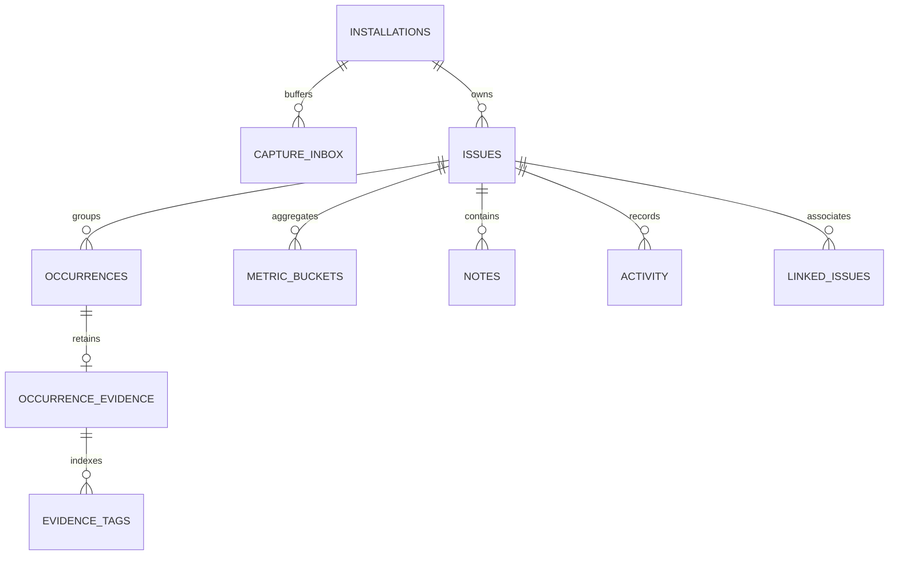
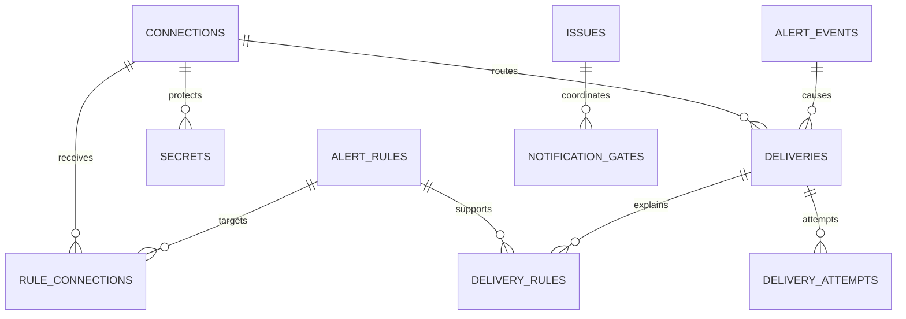

# Telescope Monitor v1 Database Schema

Status: Accepted logical design with physical migrations delivered incrementally  
Updated: 11 November 2026

This is a relational design, not executable migrations or SQL. It supports the [technical architecture](technical-architecture-v1.md) and [product specification](product-specification-v1.md). The replacement requires 25 logical tables; they cover durable capture, retained investigation, collaboration, settings, delivery, and maintenance. The existing three prototype tables are not silently upgraded to this schema.

## Physical delivery status

Phase 1 delivers installations, settings, health_checks and action_receipts. Phase 2 adds capture_inbox, issues, occurrences, occurrence_evidence, evidence_tags, metric_buckets, activity, alert_events and secrets. The approved secrets shape is introduced early for installation capture/impact keys; its nullable connection_id gains an integration foreign key when connections are implemented. Action receipts additionally have a nullable unique public_id and generation, enabling the trusted capture probe's asynchronous status and installation fence. Phase 3 investigation and lifecycle reuse these tables and add no migration. Authoritative live route/release projections now populate only when captured, and source mapping is frozen in the optional versioned evidence source section. Phase 4 adds notes, saved_views and view_preferences, plus the issue assignment index, bringing the physical schema to 16 tables and schema version 3. Phase 5 adds connections, alert_rules, rule_connections, deliveries, delivery_rules, delivery_attempts and notification_gates, and attaches secrets.connection_id to connections, bringing storage to 23 physical tables and schema version 4. Phase 6 adds linked_issues and extends connection throttling/delivery staged-key references, bringing storage to 24 physical tables and schema version 5. Phase 7 adds purge_runs and installation retention_cutoffs, completing all 25 physical tables at schema version 6. Fresh installation metadata reflects the available schema; migrations are additive and installation preserves existing configuration and published migration identities. See [current verification](replacement-progress.md#phase-2-verification).

## Storage conventions

All tables use the `exception_monitor_` prefix. The shorter names below omit that prefix for readability. Internal primary keys are unsigned 64-bit integers where supported; public resource identifiers are random UUIDs. Public IDs do not replace authorization. A table with a natural composite primary key is identified explicitly.

Use UTC datetimes with six-digit fractional precision for package-owned event/action timestamps, represented with explicit timezone in JSON. MySQL/MariaDB use a microsecond-capable datetime type; SQLite uses a consistent sortable UTC representation. Do not assume Telescope's own timestamps always have the same precision. Preserve `time_precision` when source recovery cannot supply microseconds.

Strings representing statuses or versions are validated application enums stored in ordinary columns, not database-native ENUM types. Hashes are lowercase fixed-length SHA-256/HMAC encodings. JSON columns have explicit schema versions and validated shape; JSON queries are not required for critical uniqueness or indexed filtering. Encrypted payloads/secrets use versioned long-text envelopes, not searchable encrypted JSON casts.

Unless stated otherwise, records have `created_at` and `updated_at`. Immutable events/attempts use event-specific timestamps and are append-only. Mutable user resources carry `row_version`. Issue lifecycle uses a separate `state_version`, so an incoming occurrence does not continuously invalidate a user's Resolve action.

Every record that is independently queried is installation-scoped, directly or through an authorized parent. Foreign keys enforce local identity, and writes also verify matching installation/generation. No foreign key points at a host User table or Telescope table. Index names must be explicit and short enough for all supported engines.

Deletion defaults to restricted/explicit domain deletion. Evidence tags and pure join/preferences rows may cascade from their package-owned parent. Retention and purge use different deletion policies; a cascade must never erase summaries or replay identity when evidence expires.

| Field family | Physical type contract |
| --- | --- |
| Internal IDs and foreign IDs | 64-bit integer; matching signedness/types on an engine |
| public_id, source UUIDs, source_epoch, operation/action IDs, claim tokens, client keys | Fixed 36-character UUID representation; generated public IDs are UUIDv4 |
| Fingerprints, lookup hashes, digests | Fixed 64-character ASCII hexadecimal; sensitive identity hashes use a stable keyed HMAC |
| Versions, generations, attempt counts, line numbers | Nonnegative integer with declared upper bounds; never silently wrap |
| Lifetime and aggregate counts, source sequences | Nonnegative 64-bit integer; expose potentially large values as decimal strings in JSON |
| *_at, *_until, expires_at | Nullable where specified, otherwise required UTC datetime with microseconds |
| Environment | Bounded string up to 64 characters |
| Host actor references | Bounded case-sensitive string up to 191 characters plus indexed lookup hash |
| Status, provider, action, purpose, operation, group and check keys | Bounded strings, normally up to 64 characters; registered values validated by contract |
| Display names | Up to 120 characters unless a narrower requirement applies; saved-view names stay at 80 |
| Exception class and source path | Sanitized text, bounded to 512 and 2,048 characters respectively; no full arbitrary text index |
| Sanitized message | Text bounded by the product's 16 KiB UTF-8 limit |
| Encrypted bodies and secrets | Long text with an explicit encoding/encryption version and pre-encryption byte limits |
| options, metadata, conditions, coverage, filters, preferences | Validated versioned JSON; scalar columns carry critical indexes and constraints |
| Booleans | Native equivalent with explicit defaults |

Nullable flags apply only where stated in a table definition. Saved target identities and action digests use installation-purpose keys distinct from a rotating user-impact key. Re-encrypting those stable keys during host-key rotation must not change their hash identity or create duplicate destinations. API IDs remain public UUIDs; internal IDs are not a client contract.

## Table catalog

| Area | Tables |
| --- | --- |
| Installation and configuration | installations, settings |
| Capture and investigation | capture_inbox, issues, occurrences, occurrence_evidence, evidence_tags, metric_buckets |
| Collaboration | notes, activity, saved_views, view_preferences |
| Connections and policy | connections, secrets, alert_rules, rule_connections |
| Events and delivery | alert_events, deliveries, delivery_rules, delivery_attempts, notification_gates |
| External issue association | linked_issues |
| Operational control | health_checks, purge_runs, action_receipts |

## Installation and configuration

### installations

One row per package table set. This is the fencing and configuration root, not a tenant directory.

| Column | Type and meaning |
| --- | --- |
| id / public_id | Internal PK and stable unique installation UUID |
| singleton_key | Unique short string, `default` in v1 |
| schema_version | Replacement schema marker; absent on prototype-only databases |
| state | active, draining, purging, or suspended |
| generation | Monotonic purge fence; all queued work carries its expected value |
| config_revision | Monotonic effective-configuration revision |
| source_epoch | UUID for the current configured Telescope source generation |
| source_signature | Keyed identifier for configured source connection/table identity; no password/DSN |
| source_sequence_checkpoint | Last incremental reconciliation checkpoint |
| source_sequence_floor | Purge watermark for the current source epoch |
| purged_through_at | UTC source-time cutoff preventing delayed pre-purge evidence resurrection |
| last_purge_run_id | Nullable FK to the preserved minimal purge record |
| setup_version / setup_state | Versioned non-secret checklist/probe references |

Unique: public_id and singleton_key. Generation/source cutoffs survive error-data purge. A source reset requires explicit epoch review; decreasing sequences do not reset the floor automatically.

### settings

| Column | Type and meaning |
| --- | --- |
| id / installation_id | PK and installation FK |
| group_key | General, capture, privacy, retention, or other registered preference group |
| values / values_schema_version | Validated non-secret JSON and its version |
| row_version | Optimistic edit version |
| updated_by_actor_key | Opaque host actor reference, nullable for deployment operations |

Unique: installation_id + group_key. Deployment locks are evaluated from configuration rather than copied into user-editable values. Infrastructure credentials never belong in values. An update and installation config_revision advance commit together.

## Capture and investigation

### capture_inbox

Durable sanitized input buffer; normal payload items and bounded batch-reference overflow items share this ledger.

| Column | Type and meaning |
| --- | --- |
| id / public_id / installation_id | Internal/public identity and installation FK |
| generation / source_epoch | Expected installation and source fences |
| capture_key | Stable hash of source epoch + source UUID, or of an overflow batch reference |
| kind | exception_envelope or batch_reference |
| mode | live, reconciliation, or synthetic_test |
| source_uuid / batch_uuid / source_sequence | Nullable source headers as appropriate for kind |
| environment | Bounded environment string |
| occurred_at / time_precision / received_at | Source recording time, its precision, local acceptance time |
| grouping_version / fingerprint_hash | Frozen replay-stable grouping metadata when applicable |
| privacy_revision / envelope_version | Policy and payload contract used during normalization |
| payload_ciphertext / plaintext_bytes / payload_digest | Encrypted sanitized envelope, bounded size, integrity/reference digest |
| state | pending, processing, retrying, completed, failed, or cancelled |
| attempt_count / eligible_at | Processing recovery metadata |
| claim_token / lease_until | Nullable worker claim |
| processed_at / completed_at / last_error_code | Outcome metadata with no raw exception content |

Unique: installation_id + generation + capture_key. Indexes: state + eligible_at + id; state + lease_until; installation/generation + source_sequence; completed_at. First successful buffering wins; a later reconciliation scan cannot downgrade a pending live item's mode or overwrite its envelope.

Completed items can be removed after 24 hours; the occurrence ledger remains the long-term duplicate guard. Failed items retain only bounded encrypted payloads for at most the evidence-retention window and then become payload-free failure metadata. A pending batch reference can fail visibly if Telescope prunes the source first.

### issues

| Column | Type and meaning |
| --- | --- |
| id / public_id / installation_id | Identity and installation FK |
| environment / is_test | Separate environment and synthetic groups |
| grouping_version / fingerprint_hash | Versioned grouping identity |
| exception_class / message / file / line | Latest permitted sanitized summary; bounded text and nonnegative line |
| status | unresolved, resolved, ignored, or snoozed |
| lifetime_count | Nonnegative unique occurrence count |
| first_seen_at / last_seen_at | Event-time extrema |
| resolved_at / resolution_cutoff_at | Current resolved display time and persistent precise cutoff |
| snoozed_at / snoozed_until | Current timed snooze; nullable |
| notification_cutoff_at | Persistent suppression watermark for delayed occurrence alerts |
| alert_generation | Increments for first live new-error generation and legitimate regression generations |
| assignee_actor_key / assignee_lookup_hash | Optional host reference and indexed lookup hash |
| state_version | Increments on lifecycle/assignment changes, not every occurrence |
| recovered_only | Whether no live occurrence has yet been processed for a historical-only group |

Unique: installation_id + environment + is_test + grouping_version + fingerprint_hash. Indexes: installation/environment/is_test/status + last_seen_at + id; installation + first_seen_at; installation + assignee_lookup_hash + status; status + snoozed_until.

Explicitly validate consistency between status and timestamps. `resolution_cutoff_at` survives reopening even when current `resolved_at` becomes null. Update summary content only when an occurrence is at least as recent as the previously selected latest summary. A recovered-only group receiving a routine live repeat does not invent a second “new group” notification.

### occurrences

The durable identity ledger remains after evidence expiry.

| Column | Type and meaning |
| --- | --- |
| id / public_id / installation_id / issue_id | Identity, installation FK, issue FK |
| source_epoch / source_uuid | Replay identity; UUID required for an exception occurrence |
| source_sequence / batch_uuid | Source references, nullable when unavailable |
| occurred_at / time_precision / received_at | Event and ingestion times |
| origin | web, job, command, or unknown; no request payload |
| mode / is_test | Processing provenance |

Unique: installation_id + source_epoch + source_uuid. Indexes: issue_id + occurred_at + id; installation_id + occurred_at; installation_id + origin + occurred_at. No mutable evidence body or optional user/route/tag projection is retained here. The existence of a row is the once-only guard for counts, metrics, and occurrence-generated events.

### occurrence_evidence

Expiring investigation body plus limited indexed projections.

| Column | Type and meaning |
| --- | --- |
| id / occurrence_id / installation_id | PK, unique occurrence FK, installation FK |
| evidence_version / privacy_revision | Validated serialized evidence and policy version |
| payload_ciphertext / plaintext_bytes / payload_digest | Encrypted sanitized evidence with explicit byte bounds |
| route_name / path_template | Optional permitted sanitized request projection; no query string |
| job_class / command_name / release | Optional bounded origin/release projections |
| impact_subject_hash / impact_key_id | Optional pseudonymous user-impact projection and key version |
| coverage | Versioned JSON of available/excluded/expired/truncated categories and reasons |
| expires_at | Indexed retention deadline |

Unique: occurrence_id. Indexes: expires_at + id; installation + route_name + occurrence_id; installation + release + occurrence_id; installation + impact_key_id + impact_subject_hash. Store long path text without indexing its entire arbitrary value. Each projection obeys the same privacy and expiry rules as its encrypted body.

Removing evidence removes these projections and its tags. A response must not recover them from a still-existing Telescope source entry after package retention expiry. Source links can remain, but evidence access does not silently bypass retention.

### evidence_tags

Columns: evidence_id FK, installation_id, bounded tag_key, optional bounded tag_value, and a canonical tag hash. Composite PK: evidence_id + tag_hash. Index: installation_id + tag_hash + evidence_id. Delete with evidence. Only deployment-allowlisted tags enter this table; arbitrary Telescope tags are not copied.

### metric_buckets

Columns: id, installation_id, issue_id FK, resolution (`5m` or `1h`), bucket_start_at, occurrence_count, new_group_count, regression_count, expires_at. Unique: issue_id + resolution + bucket_start_at. Indexes: installation_id + resolution + bucket_start_at; expires_at.

Per-issue rows allow exact environment/test filtering through indexed issue fields and range-frequency sorting without retaining raw snapshots. The transaction updates both eligible resolutions after inserting a new occurrence. Counts are integers; missing buckets and incomplete coverage are not equivalent to measured zero application errors.

Five-minute rows expire after 48 hours; hourly rows after 90 days by default. Late events older than a bucket's retention horizon do not recreate expired analytics. If a late historical occurrence moves an issue's first_seen_at into an earlier retained bucket, move its single new-group count from the old bucket to the new one under the issue lock. Do not double-count the group or create negative counters. Regression counters represent actual state changes, including a separately labeled historical recovery when applicable.

## Notes and activity

### notes

Columns: id/public_id, installation_id, issue_id FK, author_actor_key, author_lookup_hash, body_ciphertext, body_version, row_version, edited_at, deleted_at, deleted_by_actor_key, created_at, updated_at. Indexes: issue_id + created_at + id; installation + author_lookup_hash. Body is plain text at the interface and encrypted sanitized text at rest, bounded to 10,000 characters.

Deletion clears the body and retains a minimal tombstone. It does not preserve previous body revisions in audit JSON. The current author's identity is resolved through the host, not an Eloquent relationship. A note creation's idempotency key is represented by action_receipts, so double submission cannot create two notes or notifications.

### activity

Columns: id/public_id, installation_id, nullable issue_id FK, event_type, actor_kind (`host`, `system`, `deployment`), optional actor_key, subject_type/subject_public_id, action_public_id, occurred_at, bounded redacted metadata JSON, expires_at. Unique: installation_id + action_public_id + event_type + subject_public_id. Indexes: issue_id + occurred_at + id; installation + event_type + occurred_at; expires_at.

Records lifecycle, note metadata, assignment, export/link, settings, credential-revision metadata, and recovery actions. No note bodies, secrets, raw provider responses, or full capture payloads are duplicated here. Standalone configuration activity has no issue FK. Retention is normally 90 days. Minimal purge evidence lives in purge_runs and survives this table's purge.

## Saved views

### saved_views

Columns: id/public_id, installation_id, owner_actor_key/owner_lookup_hash, name (up to 80 characters), visibility (`personal`, `shared`), filter_schema_version, filters JSON, sort_key, relative_range JSON, row_version, created_at, updated_at. Indexes: installation + visibility + name; installation + owner_lookup_hash + updated_at. View names are not globally unique; public identity determines edits.

Filters contain only the permitted inbox definition, not SQL, result sets, credentials, or note content. Creation and editing validate feature availability. Private/shared ACLs are enforced for reads, updates, preference changes, and route resolution. Administrators may moderate shared views but do not automatically gain the ability to inspect another user's personal view through its ID.

### view_preferences

Columns: id, installation_id, actor_key/actor_lookup_hash, preferences_version, shortcuts JSON, default_view_ref nullable, row_version, timestamps. Unique: installation_id + actor_lookup_hash. One actor row serializes preference changes and stores at most 100 validated shortcut entries, each containing a saved-view UUID or built-in reference, favorite flag, and position. A single default_view_ref guarantees at most one default without database-specific partial/null uniqueness behavior. Built-in references are reserved identifiers rather than editable saved-view rows.

The JSON references are not foreign keys. Deleting or losing access to a view removes it from the effective preferences; bounded cleanup can trim stale references. Every read/favorite/reorder/default change rechecks access, so a stale shortcut cannot expose a private view. Default/favorite changes lock or version-check the one actor row rather than requiring a host-user table or cache lock.

## Connections and secrets

### connections

One email recipient is one canonical destination; the Email settings screen can manage several such records as a group. Slack/webhook connections each represent one endpoint. A GitHub connection represents one repository.

| Column | Type and meaning |
| --- | --- |
| id / public_id / installation_id | Identity and installation FK |
| provider | email, slack, webhook, or github |
| display_name | Bounded non-secret label |
| target_fingerprint | Keyed identity of normalized destination/repository |
| target_public | Non-secret validated target metadata: repository or redacted destination display |
| enabled / disconnected_at | Current availability; disconnect is not history deletion |
| options / options_version | Non-secret labels, automatic-creation settings, explicit environments |
| row_version | Optimistic configuration version |
| replaces_connection_id | Nullable FK when a changed target replaces a prior connection |
| last_test_at / last_test_outcome | Latest observed test metadata, separate from delivery state |

Unique: installation_id + provider + target_fingerprint. Indexes: installation + provider + enabled; installation + disconnected_at. Prevent duplicate aliases of the same endpoint from bypassing cooldown/deduplication.

A target is immutable after use. Repository/endpoint changes create a new canonical connection and disconnect/revalidate old work. A display-name change is not a target change. Private Slack/webhook URLs remain encrypted in secret records, not target_public. Read resources expose only permitted metadata.

### secrets

Columns: id/public_id, installation_id, optional connection_id FK, owner_key, secret_name, revision, key_id, source (`database`, `deployment`), deployment_reference, ciphertext, encryption_version, state (`staged`, `active`, `retiring`, `retired`), activated_at, retire_after, created_by_actor_key, timestamps. Unique: installation_id + owner_key + secret_name + revision. Index: installation + owner_key + secret_name + state.

The owner_key identifies an installation purpose or a specific connection. Installation-owned purposes include a stable pseudonymization/fingerprint key. A deployment reference is an allowlisted configuration identifier, never an arbitrary environment-variable name supplied by a request. Deployment-managed records have no copied ciphertext.

Enforce one active revision per owner/purpose under the installation configuration fence; no cross-database partial unique index is assumed. Active-secret changes increment config_revision. A key ID is public signing metadata, not the credential itself. On host encryption-key rotation, re-encryption preserves the logical secret revision; failures are visible and stop affected work. Retired transport-key ciphertext is cleared after its explicit transition deadline and any required in-flight grace; retain only revision metadata. Stable installation identity/digest keys and currently active credentials are not eligible for that cleanup.

## Rules and alert events

### alert_rules

Columns: id/public_id, installation_id, name, enabled, definition_version, event_types JSON, conditions JSON, optional threshold_count/window_seconds, cooldown_seconds, created_by_actor_key, row_version, deleted_at, timestamps. Index: installation + enabled + deleted_at. Fixed v1 threshold windows are 300, 900, or 3600 seconds; cooldown and counts have deployment upper limits and nonnegative/positive validation.

Definitions are versioned and validated, not executable expressions. Event types come from the product's versioned catalog. Conditions use permitted environment, exception class, origin, and tag fields. Soft deletion preserves historical references but removes current eligibility. Existing history snapshots cannot reactivate a deleted rule.

### rule_connections

Columns: rule_id FK, connection_id FK. Composite PK: rule_id + connection_id; reverse index on connection_id. Validate matching installation and a notification-capable provider. GitHub ticket automation is not treated as an email/Slack notification destination; its opt-in connection policy plans a separate issue-create action.

### alert_events

| Column | Type and meaning |
| --- | --- |
| id / public_id / installation_id / issue_id | Identity, installation FK, optional issue FK for installation tests |
| generation | Purge fence |
| event_type / event_version | Domain event contract |
| event_key | Unique deterministic keyed identity for source occurrence, rule/window, or user action |
| occurrence_id / action_public_id | Nullable source references |
| issue_state_version / alert_generation | Causal lifecycle generation |
| occurred_at / recorded_at | Event and processing times |
| provenance | live, reconciliation, synthetic_test, or user_action |
| actor_key | Nullable initiator for user-originated actions |
| payload_ciphertext / payload_version / payload_digest | Bounded sanitized event snapshot; no credentials or note body |
| planning_state / expires_at | Eligibility/planning state and safe terminal-retention deadline |

Unique: installation + generation + event_key. Indexes: issue_id + occurred_at; planning_state + id; expires_at. Record recovered lifecycle activity with notification eligibility disabled, not as a normal live alert.

Threshold event identity includes rule UUID/version, issue, and window start. Indexed occurrence/evidence/tag projections calculate the matching count under the issue lock; no separate threshold counter table is necessary in v1. Event retention must exceed the retry/threshold horizon, and pending references prevent premature removal.

## Delivery ledger

### deliveries

| Column | Type and meaning |
| --- | --- |
| id / public_id / installation_id | Identity and installation FK; public_id is the stable logical delivery ID |
| generation | Purge fence |
| issue_id / event_id / connection_id | Nullable issue/test reference, primary alert-event FK, canonical target FK |
| action | notify, github_create, connection_test, or explicit supported review action |
| dedupe_key / revision | Unique coalesced logical intent and its explicit resend revision |
| parent_delivery_id | Nullable self-reference for a separately reviewed resend |
| target_fingerprint | Immutable target identity rechecked at attempt time |
| actor_key / actor_required | Identity whose current permission is required for a manual external write |
| event_family / alert_generation | Occurrence/activity/ticket arbitration metadata |
| status / cancellation_reason | Product delivery state and bounded reason code |
| eligible_at / expires_at | Due time and automatic-obsolescence deadline |
| attempt_count_total / retry_cycle / cycle_attempts | Total history and bounded budget for an audited retry cycle |
| claim_token / lease_until | Current claim and expiry |
| payload_ciphertext / payload_version / payload_digest | Canonical body or approved GitHub export; never credentials |
| payload_frozen_at / export_policy_revision | Freeze point and policy used |
| sent_at / completed_at / last_error_code | Outcome metadata |

Unique: installation_id + generation + dedupe_key + revision. Indexes: status + eligible_at + id; status + lease_until; issue_id + created_at + id; connection_id + status; completed_at. A dedupe key coalesces event/action/destination, not a display label.

Notification payloads freeze before their first attempt. A manual GitHub export freezes at explicit preview confirmation; stricter later export policy requires review rather than unapproved rewriting. A changed immutable body requires a new logical delivery revision/UUID. Ordinary unchanged retries retain the ID and bytes. Pending intent remains present when queue dispatch fails.

### delivery_rules

Columns: delivery_id FK, nullable rule_id FK, rule_public_id, rule_version, matching_event_id FK, sanitized conditions_snapshot JSON. Composite identity: delivery_id + rule_public_id + rule_version + matching_event_id. Index: rule_id + delivery_id. This records every rule/event supporting a coalesced delivery, including simultaneous threshold matches. Rule deletion removes current support without erasing historical explanation.

Snapshots contain condition metadata, not secret-bearing destinations. The sender validates current applicable rule support before automatic sends; historical snapshots alone are insufficient.

### delivery_attempts

Columns: id/public_id, installation_id, delivery_id FK, sequence_number, retry_cycle, claim_token, started_at, completed_at, outcome, provider_status, safe_error_code, sanitized_error_summary, retry_after_at, used_secret_key_id, optional validated_remote_reference. Unique: delivery_id + sequence_number. Indexes: delivery_id + started_at; completed_at.

Record an actual network attempt separately from a cooldown wait or duplicate dispatched job. No raw HTTP headers, endpoint credential, exception trace, response body, or live mail message is retained. A validated accepted GitHub number/URL can support recovery even if the delivery's final commit fails; uncertain results still require appropriate review.

### notification_gates

Columns: id, installation_id, issue_id FK, target_fingerprint, event_family, last_sent_at, last_event_public_id, reserved_delivery_id FK nullable, reservation_token, lease_until. Unique: issue_id + target_fingerprint + event_family. Index: lease_until.

Occurrence-family rules share a gate so overlapping rules cannot independently bypass cooldown. Different actual email recipients have different canonical targets. Gates serialize reservations across different delivery rows; the unique delivery key alone does not solve that race. Provider acceptance advances cooldown; failed attempts release the reservation. Activity families have their explicitly defined rule cooldown scope rather than inheriting occurrence suppression accidentally.

## Linked external issues

### linked_issues

Columns: id/public_id, installation_id, issue_id FK, connection_id FK, repository_fingerprint, repository_owner/name, state (`reserved`, `creating`, `linked`, `needs_review`, `unlinked`, `unavailable`), operation_public_id, create_delivery_id FK nullable, remote_number nullable, remote_url nullable, last_known_remote_state nullable, checked_at nullable, linked_by_actor_key, row_version, timestamps. Unique: issue_id + repository_fingerprint. Indexes: connection_id + state; repository_fingerprint + remote_number.

The unique local issue/repository reservation prevents independent duplicate creation. The same remote issue may intentionally link to several local errors, so repository/remote_number is not globally unique. URL construction/validation uses the configured repository and supported GitHub origin, not an arbitrary returned URL.

Unlinking preserves a tombstone/operation history. A subsequent link/create decision requires an explicit new operation and version check. Changing the display name of a connection does not invalidate a valid link. Connection target changes cannot redirect it. External ticket state is last-known and timestamped, with unavailable distinct from closed.

## Operations and command receipts

### health_checks

Columns: id, installation_id, check_key, evidence_kind (`configuration`, `observation`, `probe`), state, observed_at, last_started_at, last_success_at, last_failure_at, sanitized_details JSON, optional operation_public_id, row_version. Unique: installation_id + check_key. Index: state + observed_at.

This stores latest bounded observations/checkpoints, not an unbounded log stream. A scheduled-command start does not overwrite last_success_at. Store processing/reconciliation coverage and watermark lag here, without source payloads or DSNs. Heartbeats never claim independent application availability.

### purge_runs

Columns: id/public_id, installation_id, from_generation, to_generation, source_epoch, source_sequence_floor, source_time_cutoff, initiated_by_actor_key or deployment label, confirmation_digest, state, current_step, bounded deletion_counts JSON, started_at, completed_at, safe_error_code. Unique: installation_id + to_generation. Index: installation_id + state.

Preserve this minimal ledger through the purge it controls. A resume continues the same run rather than creating a second reset. Its metadata contains no deleted note, evidence, credential, or exported body. The installation points to the last run and preserved cutoffs.

### action_receipts

Columns: id, installation_id, actor_lookup_hash, actor_key, operation, client_key, keyed_request_digest, state, result_type/result_public_id, resulting_row_version, created_at, completed_at, expires_at. Unique: installation_id + actor_lookup_hash + operation + client_key. Index: expires_at; state + created_at.

This provides idempotent user creation/external-action commands without storing their inputs. Authorize every request, including a replay of a completed key. Same key + different canonical request returns conflict. Keep completed receipts at least 24 hours and longer while their referenced action is pending. When an external-create receipt expires, linked_issues/deliveries still prevent blind duplicate creation. Personal-view operations must not expose another actor's result through a guessed key.

## Core relationships

These are relationship summaries; scoped nullability, uniqueness, and retention rules above remain authoritative. Hosts and Telescope have reference identifiers only, not database foreign keys.

## Query and indexing rules

Inbox predicates use typed, allowlisted filters. Bind text-search parameters and escape wildcard syntax when the UI promises literal search; never interpolate sort column names. Start with portable class/message search, bounded to 200 characters, and measure its supported volume. Engine-specific full-text search is a later measured optimization, not an undocumented dependency.

Use a deterministic ID tie-breaker for every sort. Occurrence/history queries use keyset pagination where appropriate; the UI may expose a simpler next/previous control without materializing all pages. Overview/new-group/range counts and issue lifetime counts have distinct labels and definitions.

Batch-load current-page evidence metadata, linked-issue summaries, and host actor labels to avoid N+1 queries. Decrypt only authorized selected evidence/delivery detail, not an entire inbox page. Privacy projections and tag filters use only unexpired evidence. One-hour threshold counting uses the same indexed matching criteria as its rule, under the issue lock.

## Retention and migration rules

Ordinary retention deletes occurrence_evidence and evidence_tags, expired metric_buckets, completed delivery bodies/attempts and eligible alert_events, expired activity, and safe action receipts. It never decrements issue lifetime_count or deletes occurrences. Notes, saved views, connections, credentials, and linked issues have their own explicit removal rules.

Respect pending references: do not remove an event, payload, actor requirement, or GitHub reservation while a delivery still needs it. Terminal delivery cleanup removes delivery_rules and attempts in a defined order; linked GitHub metadata remains even if its create_delivery reference is cleared. Do not let a retention cascade remove an external association.

A whole-installation purge drains claims, advances generation/cutoffs, then clears capture_inbox and deletes the error-domain graph in a resumable ordered plan, including gates, links, events, attempts, deliveries, evidence/tags, metrics, notes, occurrences, and issues. It removes error-specific activity and obsolete action receipts while preserving configuration, credentials, saved views/preferences, installation identity, purge history, and bounded operational verification. Stale queue items fail their generation check.

Fresh migrations create parents first, then children, and add optional back-reference constraints such as installations.last_purge_run_id in a final pass. Publishing is idempotent. A database containing prototype tables without the replacement schema marker must stop with a precise diagnostic and backup/conversion/reset instructions. No migration may infer permission to drop prototype data. Post-baseline upgrades must be additive/backfillable where practical, with fixtures for mixed old/new serialized payload versions and a declared schema compatibility policy.

The physical engine matrix must validate nullable FK behavior, timestamps, unique-key races, lease claims, upserts, pruning, and index plans. Avoid relying on nullable uniqueness, PostgreSQL-only partial indexes, database JSON expressions, or SKIP LOCKED for correctness across all proposed engines.
