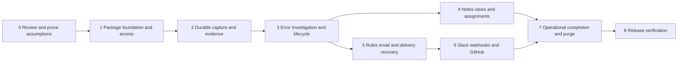

# Telescope Monitor v1 Phased Implementation Plan

Status: Accepted roadmap and replacement implementation started

This plan follows the approved product scope, wireframes, and Telescope-themed mockups. It depends on the proposed [technical architecture](technical-architecture-v1.md) and [logical schema](database-schema-v1.md). The user subsequently authorized cleanup and a fresh implementation. [Current progress](replacement-progress.md) records the verified archive, foundation, durable capture and Phase 3 investigation and Phase 4 collaboration plus Phase 5 email alerting and Phase 6 integrations plus Phase 7 operations delivery, and remaining phases. Live external messages and publication are not implicit in that authorization.

## Delivery principles

Build vertical journeys with their UI, authorization, state handling, and persistence together. Setup, settings, privacy, delivery history, and health begin in the foundation and grow with each capability. They are not deferred to a cosmetic final pass.

Internal milestones can be incomplete versions of v1, but must not be described as the finished product. Each milestone has observable exit evidence. The public v1 release includes all selected channels, notes, saved views, optional assignments, and the required operational behaviors.

Architecture review and the instruction to begin implementation are complete. Preserve the current prototype and its verification notes before replacement work, as recorded in the progress document. Reuse tests that capture valid behavior; do not carry forward the old three-table scope or Blade-only stack merely because it already exists.

## Dependency map

Work can be scheduled independently where dependencies allow, but correctness does not depend on separate agents or teams. The implementation should use the existing suitable checkout unless a later request calls for a new worktree.

## Phase summary

| Phase | User-visible milestone | Exit evidence |
| --- | --- | --- |
| 0 | Reviewed architecture and a safe replacement approach | Decisions and source/queue/database assumptions verified in bounded experiments after implementation is authorized |
| 1 | A clean host opens the real dashboard shell and resumable setup | Discovery, compiled assets, authorization, locks, and repeat installation work |
| 2 | Real errors arrive asynchronously with safe retained evidence | HTTP/job/command capture, replay, concurrency, bounds, and evidence expiry verified |
| 3 | Developers can investigate, triage, and understand trends | Overview, inbox, occurrence detail, lifecycle, and unavailable states work |
| 4 | Investigations can be recorded and revisited | Notes, personal/shared saved views, and optional assignment behavior verified |
| 5 | Administrators can configure and receive actionable email alerts | Rule evaluation, deduplication, cooldown, delivery history, and recovery work |
| 6 | The product connects to the selected external tools | Slack, signed webhooks, and GitHub creation/linking/review journeys pass |
| 7 | Administrators can operate the complete installation safely | Configuration freshness, health observations, retention, purge fencing, and full setup completion verified |
| 8 | A releasable package installs into fresh supported applications | Full acceptance matrix, compatibility, upgrade, assets, and documented operations pass |

## Phase 0 Review and prove assumptions

Agree the Vue/TypeScript package shell, database support targets, capture buffering, identity providers, secret handling, and prototype replacement policy before changing production source. Confirm that the approved desktop mockups describe the shared theme rather than literal generated pixel measurements.

Once implementation is explicitly authorized, preserve the prototype as a dated snapshot with file hashes and verification notes. Do not drop a database or overwrite consumer configuration. Identify whether prototype data needs an explicitly scoped converter; the default release path is fresh installation of the replacement.

Bounded technical experiments must establish:

- The supported Telescope callback order, reportability marker path, mutated-content handling, and source references, without modifying vendor code or reordering third-party callbacks.
- HTTP, synchronous jobs, retrying/terminal queued jobs, and command exception reporting behavior.
- Availability and bounds of request/log/query/job context in accepted batches and safe behavior when it is absent or pruned.
- Exclusion/redaction of the monitor's own request/response traffic in Telescope, including credentials, notes and one-time secret reveals, with no change to application entry/batch filter callbacks.
- Durable inbox commit and failed queue-dispatch recovery, including a sync-queue deployment that must not send externally in a monitored request.
- Microsecond live timestamps, coarser recovery timestamps, source reset detection, and deterministic resolution/purge cutoffs.
- MySQL/MariaDB grouping races, SQLite serialized-write behavior, and lock-order feasibility.
- A standalone compiled Vue shell at a non-default route prefix, under host sessions, CSP, and CSRF protection, without a host frontend build.

Proposed measurement profiles are 1,000 and 10,000 captured occurrences/day equivalents, bursts of 100 exceptions per batch, and an overflow stress case of 1,000 exceptions per batch. These are experiment inputs, not supported throughput claims. Include a large identity ledger and bounded retained-evidence dataset to evaluate query/prune behavior before publishing volume guidance.

Exit: a short results record resolves or rejects each assumption, the candidate compatibility floor is locked for tests, and any material architecture change returns to review. No experiment silently expands Telescope collection policy.

## Phase 1 Package foundation and access

Implement package discovery, non-destructive publishing, schema ownership detection, installation identity/configuration revision, scoped route families, actor/capability adapters, and the compiled dashboard shell. Establish repository conventions, immutable DTO/resource contracts, structured errors, idempotency receipts, and optimistic edit versions.

Build the six-screen navigation/theme primitives from the approved mockups, with feature availability driven by server capabilities. Unavailable modules show a truthful setup/state explanation during internal development; do not expose buttons that imply implemented external actions. Ship fonts/icons and their notices locally. Build tooling belongs to package development, not consumer installation.

Start onboarding and Settings now: installation checks, application preferences, deployment-locked values, empty/error states, access guidance, and resumable checklist state. Current effective preferences are distinct from host configuration. Establish health observations for installation and configuration before adding capture metrics.

Tests and demonstrations:

- Install into a clean supported host, discover provider, publish, migrate, and open a deep link without Node on the consumer side.
- Repeat installation preserves configuration and migration identity.
- Existing prototype tables produce an explicit ownership diagnostic rather than destructive migration.
- Viewer/operator/administrator capabilities are enforced for routes and JSON; guessed personal-resource IDs and idempotency keys do not bypass authorization.
- Session expiry, forbidden actions, stale edits, CSP, asset path allowlisting, safe login return paths, and a configured non-default base path behave correctly.

Exit: a real host can open the approved shell and setup flow, with working authorized configuration persistence and compiled asset delivery. Acceptance focus: SETUP-01, SETUP-02, AUTH-01, AUTH-02, CONFIG-01, HEALTH-01, UI-01.

## Phase 2 Durable capture and retained evidence

Implement the Telescope adapter, normalization and privacy enforcement, versioned source markers, durable inbox, processing jobs, replay identity ledger, error grouping, evidence/projections, and bounded source reconciliation. Create first-seen/count/event-time metric storage and baseline health observations. Rules/integrations remain inactive until their phase; capture must not pretend email delivery is already available.

Add basic retention of processed inbox bodies and expired evidence as soon as those records exist. Store only the product's allowed context and explicit coverage reasons. Introduce processing-lag and failed-item administration states in onboarding/health.

Tests and demonstrations:

- Real reportable HTTP, job, and command exceptions produce correct retained groups through actual Telescope storage.
- Entry/batch filters, disabled watchers, synthetic events, current privacy bounds, and package-loop exclusions work.
- Duplicate source UUIDs, replay after evidence expiry, concurrent first occurrences, and failed transactions preserve counts and unique intent.
- Broker outage, killed capture worker, stale lease, malformed/unknown envelope version, decryption failure, and pruned batch-reference source have visible bounded recovery.
- Literal source secrets, trace arguments, request payloads, query values, and arbitrary log context are excluded/redacted before package persistence.
- The trusted onboarding probe respects disabled/paused recording, while untrusted jobs/requests cannot opt themselves into test capture. Reused HTTP/queue workers do not leak recording or actor state across operations.
- Coarse/out-of-order timestamps do not create false regressions. Reconciliation is incremental with overlap and cannot starve older gaps by scanning only a newest page.

Exit: real errors are buffered and processed safely; evidence remains viewable after source pruning; processing and coverage limitations are observable. Acceptance focus: CAP-01, CAP-02, CAP-03, CAP-04, DATA-01, DATA-02, RETAIN-01, HEALTH-01, SAFE-01.

## Phase 3 Investigation and lifecycle

Implement overview, inbox, deterministic filtering/sorting/pagination, selected-occurrence routing, trace/context/timeline, and correctly scoped insights. Add resolve/reopen/ignore/timed snooze, expiry, activity, persistent suppression cutoffs, and source-link handling using captured immutable release mapping.

Wire the approved desktop compositions to real query projections, and complete responsive/keyboard forms for the same workflows. Keep occurrence and lifetime counts distinct. Preserve filters/back navigation and cancel stale detail requests. Build no-data, excluded, unavailable, truncated, and expired-evidence states rather than empty placeholder panels.

Tests and demonstrations:

- A notification-style deep link authenticates and opens the right occurrence; changing occurrence updates every evidence panel together.
- Lifecycle actions are idempotent, authorized, versioned, and recorded. Count-only updates do not constantly reject an operator's Resolve action.
- Old captures after resolve/unsnooze/reopen do not immediately create false state transitions or alerts.
- Snooze expiry works with an unavailable scheduler once ingestion resumes; suppressed historical events are not replayed as new notifications.
- Chart/range counts remain correct after pruning, late first occurrences relocate the single new-group count correctly, and test/recovered data are labeled.
- No snapshot means no invented route/user/release insight; current deployed code is not presented as historical source.

Exit: an operator can investigate a real retained occurrence and manage its lifecycle from the approved UI. Acceptance focus: CAP-04, DATA-02, DATA-03, LIFE-01, UI-01.

## Phase 4 Notes saved views and optional assignments

Implement notes with safe display, authorship, editing conflicts, body removal, and metadata-only activity. Implement built-in inbox views, personal/shared saved definitions, save/update/copy/rename/delete flows, and per-actor favorites/defaults/order. Add optional assignment-directory and actor-resolution behavior without adding package-owned users.

Connect the supporting panels to the approved error-details and overview/inbox compositions. Assignment controls remain absent until configured; administration explains the host provider requirement. Notes do not silently become external ticket content.

Tests and demonstrations:

- Duplicate note submission produces one note. Authors edit their own content; only permitted moderators remove others' notes. Deletion does not leave a duplicate body in audit metadata.
- Private views remain private through read/edit/preference routes; shared publication and moderation are separately authorized.
- A modified loaded view is not silently overwritten; save a copy and stale-edit recovery work.
- Unsupported saved filters have a repair state, and favorites/defaults never grant access to an unavailable view.
- Assignment directory failure, removed users, provider disable/re-enable, stale actor resolution, and unavailable assignees behave explicitly.

Exit: developers can record and revisit an investigation, with or without assignment integration. Acceptance focus: NOTE-01, VIEW-01, ASSIGN-01, AUTH-02, UI-01.

## Phase 5 Rules email and durable delivery

Implement typed alert rules, canonical email destinations, immutable alert events, coalesced delivery intent, supporting-rule references, cooldown reservations, attempts, claims, expiry, and audited retry cycles. Connect the rule editor, payload previews, email setup/tests, delivery history/detail, and queue/scheduler health observations.

Use the host mailer through the provider interface. Do not adopt user-notification models or serialize mail context into queue jobs. Start with controlled transports/array or local test mailers; live acceptance checks require explicitly selected test destinations.

Tests and demonstrations:

- New/regression/threshold/activity events match the correct conditions, provenance, origin/tag filters, and destinations.
- Two overlapping rules or two senders cannot bypass destination deduplication or cooldown; different email recipients remain independently deliverable.
- Resolve/ignore/snooze cancellation, activity-specific eligibility, deleted/edited rules, removed recipients, pending expiry, and failed-mail retries follow the product contract.
- Kill a worker before claim, during send, after provider acceptance, and before local completion. Verify bounded at-least-once recovery and honest history.
- A dispatch failure leaves durable intent. A sync queue never causes automatic external delivery inside an ordinary monitored request.
- Payloads freeze at the correct point; stricter privacy cancels incompatible retries; reviewed resend gets a new identity.

Exit: a real new error and regression can deliver the intended email and remain diagnosable/recoverable through the UI. Acceptance focus: ALERT-01, ALERT-02, ALERT-03, CAP-03, CONFIG-01, SAFE-01, UI-01.

## Phase 6 Slack webhooks and GitHub

Add the remaining provider adapters, connection editors, encrypted credentials, test operations, destination validation, and required integration-history states. Reuse the delivery module rather than building independent queue/retry systems for each provider.

Slack slice: incoming webhook configuration, escaped messages, secret replacement, throttling, explicit tests, and separate connection/delivery outcomes.

Webhook slice: versioned canonical payload, exact-body signatures, stable logical IDs, timestamp verification guidance, staged key rotation, HTTPS/DNS/address policy, and controlled endpoint tests. Do not rely on URL validation alone or follow redirects with credentials.

GitHub slice: repository-scoped credentials, read-only connection checks, preview-confirmed manual creation, validated existing issue linking, reservation uniqueness, optional new-error automation, last-known ticket state, and Needs review recovery. Repeated occurrences and regressions retain their association without automatic close/reopen synchronization.

Tests and demonstrations:

- Slack formatting cannot introduce unintended mentions, and credentials do not leak into Telescope, logs, Resources, or attempt summaries.
- Webhook receiver checks exact raw-body signing input, key IDs, rotated keys, timestamps, retry identity, and receiver-side deduplication. SSRF tests include redirects, disallowed addresses and DNS changes.
- GitHub double-clicks/concurrent workers produce one reserved operation. Lost response, provider acceptance followed by a database failure, expired creation lease, and missing search results do not lead to blind duplicate creation.
- Link validation rejects unrelated repositories/PRs; deleted/revoked initiators cancel pending user-requested writes.
- Runtime credentials are loaded under current policy; changing a target cannot redirect pending work to a new endpoint/repository.

Exit: all four selected integration types work through real product flows and controlled provider contracts. Acceptance focus: GITHUB-01, GITHUB-02, SLACK-01, WEBHOOK-01, ALERT-03, CONFIG-01, AUTH-02, DATA-01, SAFE-01, UI-01.

## Phase 7 Operational completion retention and purge

Complete the accumulated administration/onboarding journeys: truthful processing observations, probe receipts, connection state, configuration precedence, worker freshness, retention impact previews, pruning history, source reset guidance, and all remaining setup checklist transitions.

Implement/resume the complete retention graph, note/view/link preservation, minimal UUID identity, aggregates, and safe terminal delivery/event cleanup. Add the explicitly confirmed deployment purge with draining, fences, cutoffs, preserved installation state/settings/credentials/views, resumable deletion, and final verification.

Tests and demonstrations:

- Settings locks and hard limits are enforced server-side; concurrent admin edits and missed cache invalidation cannot leave workers acting on stale policy.
- Key loss and rotation fail visibly without destroying credentials or exporting forbidden evidence.
- Pruning across a large dataset is bounded, preserves counts/notes/views/links, and never lets selected detail silently rehydrate evidence past retention.
- Purge interrupted at every step resumes safely. Old queued jobs, delayed source storage, replay, and stale claim completions cannot resurrect purged data or send new work under the prior generation.
- Telescope source reset requires explicit rebaselining; it does not silently discard purge protection.
- Health separates configuration, starts, successful observations, failures and unverified checks. A completely offline host is not described as independently monitored.

Exit: an administrator can complete setup and maintain the installation without inspecting implementation files for routine operational preferences. Acceptance focus: CONFIG-01, RETAIN-01, RETAIN-02, HEALTH-01, UI-01, SAFE-01.

## Phase 8 Release verification and documentation

Run the full product acceptance matrix after all vertical slices are integrated. Verify the six main screens and supporting editors/states against the approved direction, with a consistent theme, responsive composition, accessible controls, safe navigation, and no prototype-only review controls or sample values in production screens.

Release checks include:

- Fresh Composer installation into clean supported Laravel applications, without a consumer Node installation or host frontend modifications.
- Repeat install, additive migration publication, a declared pre-release-to-release upgrade fixture, and unsupported prototype-schema detection.
- Exact supported PHP/Laravel/Telescope combinations and each claimed database engine, with real concurrent workers rather than SQLite-only assertions.
- Database and Redis queue candidates, their timeouts/leases, worker death, unavailable broker, scheduler gaps, and recovery after restart.
- Retained snapshots after Telescope pruning; stable counts and metrics after package retention; controlled purge/reconciliation across source epochs.
- Controlled external test destinations for provider contracts, without claiming that an array mailer proves inbox delivery.
- Versioned assets, self-hosted fonts, licenses/notices, package discovery, config defaults, static analysis, formatting, dependency checks, and archive contents.
- Operator documentation for authorization/actor providers, queue/scheduler deployment, secret rotation, settings locks, network restrictions, retention, and safe upgrades.

Exit: all 28 product acceptance requirements have current passing evidence, known limitations are stated precisely, and the final package vendor/name and release artifact are reviewed before publication. Publication is a separate authorized action, not a side effect of tests or document approval.

## Acceptance traceability

| Product requirement | Primary phase | Additional verification |
| --- | --- | --- |
| SETUP-01 | 1 | 7 and 8 |
| SETUP-02 | 1 | 8 |
| AUTH-01 | 1 | Every mutation/read slice and 8 |
| AUTH-02 | 1 | 4, 6, and 8 |
| CAP-01 | 2 | 8 |
| CAP-02 | 2 | 8 |
| CAP-03 | 2 | 5 and 8 |
| CAP-04 | 2 | 3 and 8 |
| DATA-01 | 2 | 6 and 8 |
| DATA-02 | 3 | 7 and 8 |
| DATA-03 | 3 | 8 |
| LIFE-01 | 3 | 5 and 8 |
| NOTE-01 | 4 | 8 |
| VIEW-01 | 4 | 8 |
| ASSIGN-01 | 4 | 8 |
| ALERT-01 | 5 | 8 |
| ALERT-02 | 5 | 6, 7, and 8 |
| ALERT-03 | 5 | 6 and 8 |
| GITHUB-01 | 6 | 8 |
| GITHUB-02 | 6 | 8 |
| SLACK-01 | 6 | 8 |
| WEBHOOK-01 | 6 | 8 |
| CONFIG-01 | 1 | 5, 6, 7, and 8 |
| RETAIN-01 | 2 | 7 and 8 |
| RETAIN-02 | 7 | 8 |
| HEALTH-01 | 1 | 2, 5, 7, and 8 |
| UI-01 | 3 | 1, 4, 5, 6, 7, and 8 |
| SAFE-01 | 2 | 5, 6, 7, and 8 |

## Risks and decision gates

| Risk | Decision or evidence required before depending on it |
| --- | --- |
| Telescope hook ordering or watcher behavior changes | Phase-zero compatibility fixtures; reconciliation limits documented |
| Context unavailable after source pruning or filtering | Explicit coverage states, bounded durable buffering, controlled replay tests |
| Shared host database contention | Measured capture/claim/prune profiles and query plans before throughput claims |
| SQLite differs from row-locking databases | Engine-specific correctness tests and explicit support/workload statement |
| Worker configuration or cache invalidation is stale | Database configuration revisions, recovery sweeps, truthful health observations |
| External creation outcome is ambiguous | Needs review reservations and explicit operator recovery |
| Credentials or payloads leak through transport errors | Guarded adapters and adversarial logging/export tests |
| Purge races with source writes or live workers | Draining, generation fencing, source epoch/watermarks, interruption fixtures |
| Rich UI introduces host build/runtime coupling | Package-owned document/assets and clean-host tests |
| Scope drifts back to performance/SaaS parity | Product exclusions remain explicit; changes return to planning |

Calendar estimates should follow the phase-zero experiment results and available implementation capacity. The phase order and exit criteria can be agreed now without inventing a delivery date.

## Next decision

Continue through the acceptance gates in order. Architecture, the Vue stack, and the instruction to start fresh have been accepted. Foundation completion is not full v1 completion; capture/performance experiments and the remaining vertical slices must still be implemented and verified.
