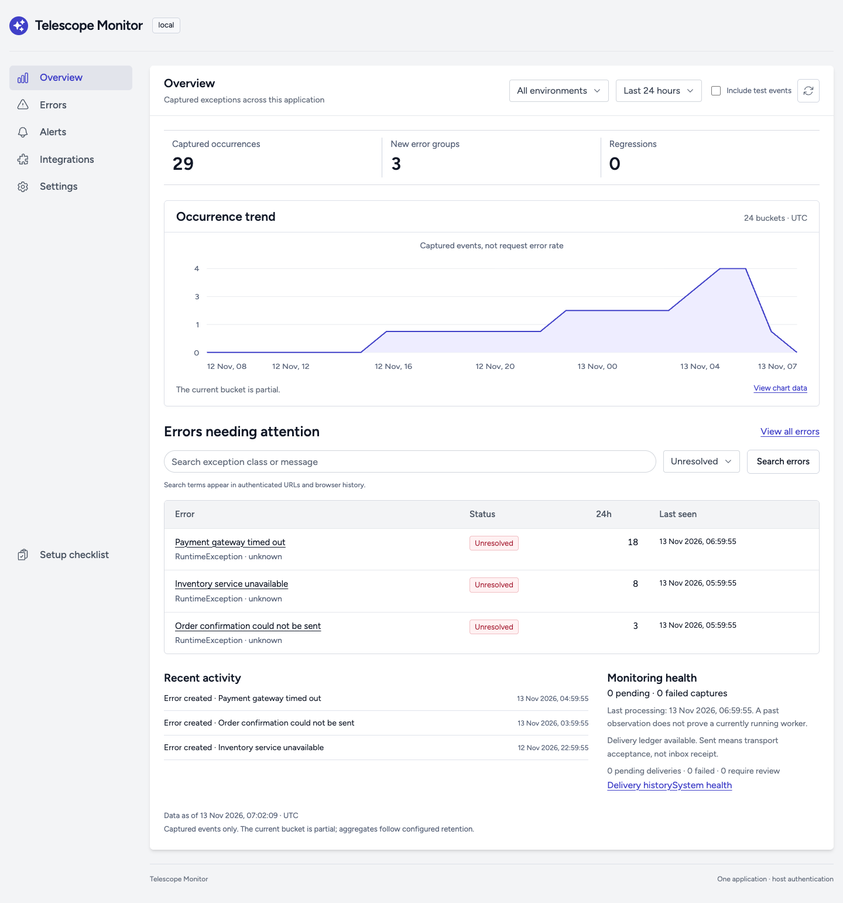
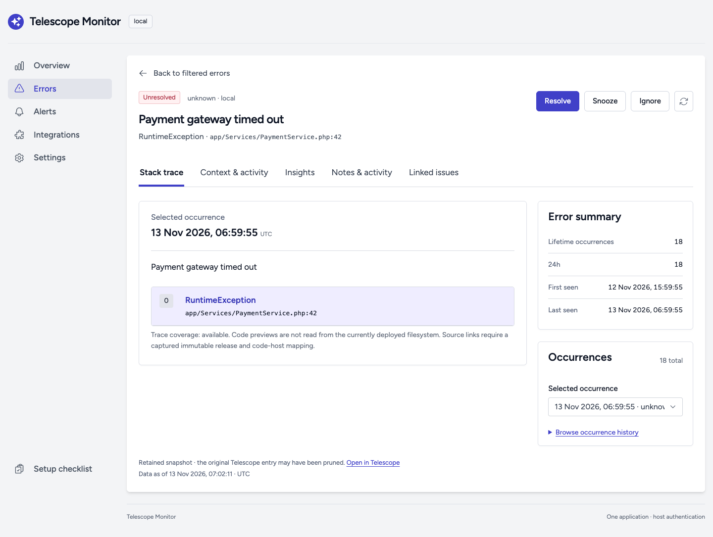
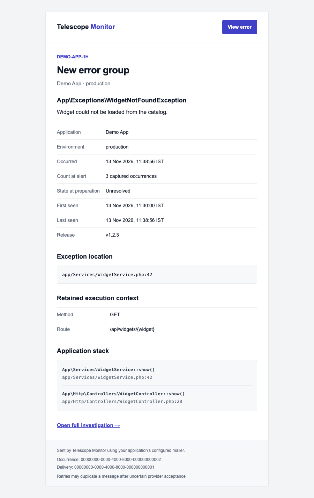
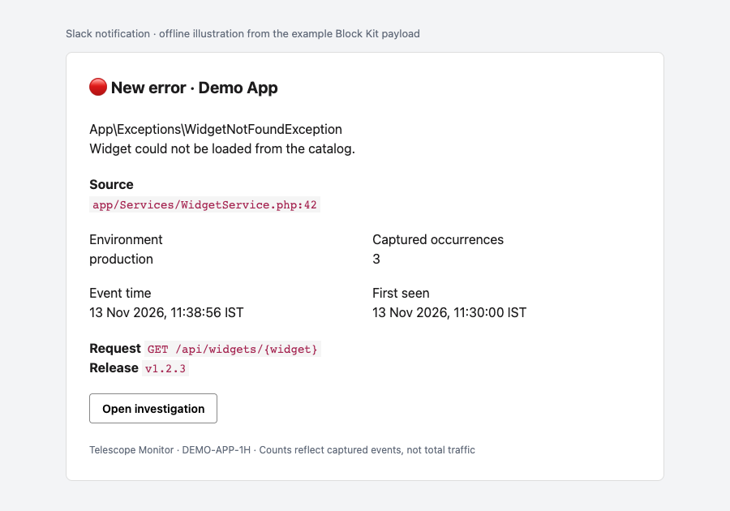
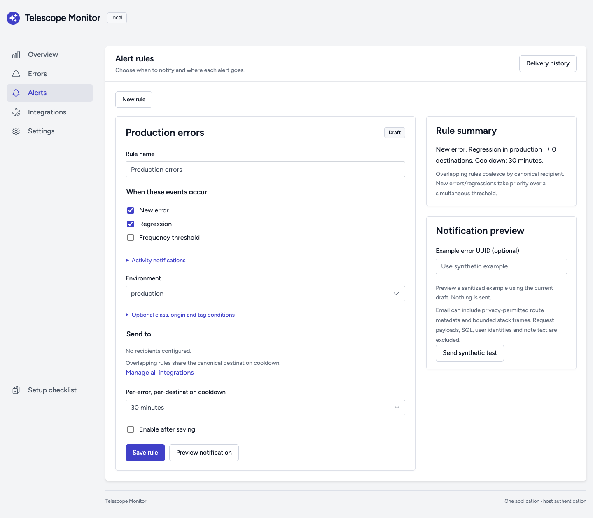
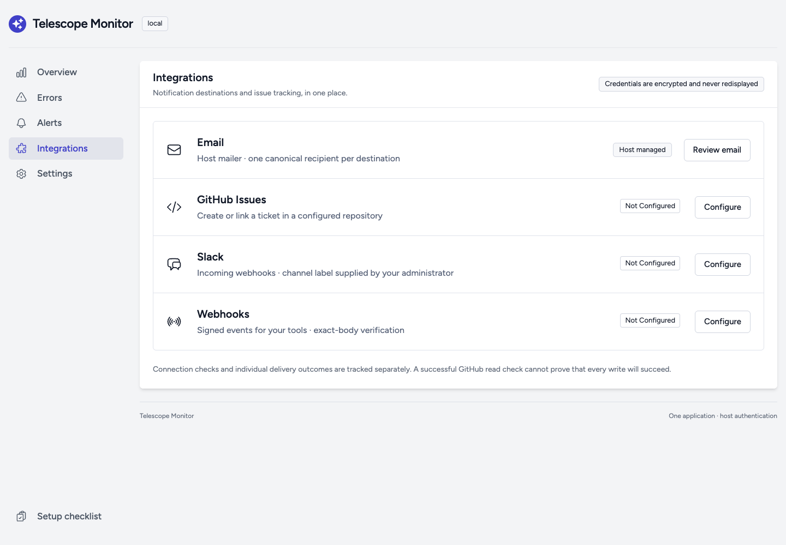

# See Telescope Monitor in action

Explore the dashboard and notifications before installing the package. Dashboard captures use an isolated local workbench with synthetic errors. Notification examples use a fictional Demo App and reserved `example.test` URLs; no notifications were sent. These are separate examples, not one shared incident.

## From exception to investigation

1. Your application reports an exception and Telescope stores it under your existing filters.
2. The background importer sanitizes the retained evidence and groups matching occurrences into an error.
3. Enabled rules match events and environments, then queue deliveries to their selected destinations, subject to cooldowns.
4. Open the notification's investigation link, review the selected occurrence, and resolve, snooze or ignore the error. A resolved error that occurs again can trigger a regression alert.

Counts describe captured exceptions, not total request traffic or an application error rate. Available context depends on Telescope's enabled watchers, retained source entries and the monitor's privacy policy.

## Monitor the application

The overview shows captured occurrences, new groups, regressions, a trend chart and errors needing attention. Filter by environment and time window, then open an error to investigate it. Recent activity and monitoring health appear further down the page.

## Investigate and respond

An error brings together its retained stack, occurrence history, context, insights, notes and linked issues. Select an occurrence to inspect its evidence; resolve, snooze or ignore the group from the same screen. Optional assignments require a host directory adapter.

## Receive email alerts

Email includes the exception, environment, captured occurrence count, timestamps, source location and an investigation link. When retained evidence and privacy settings allow it, the message also includes execution context and application stack frames. It uses your Laravel mailer and includes a plain-text alternative.

This screenshot is rendered from the package's actual Blade email template using a [synthetic envelope](examples/email-notification.json). Mail clients may lay it out differently.

## Notify a Slack channel

Slack alerts include an event heading, exception summary, source, environment, captured count, event and first-seen times, and an **Open investigation** button. Available route/job/command and release context can appear too. Raw request bodies, headers and user details are excluded.

The image below is an **offline illustration of the example Block Kit payload**, not a screenshot of the Slack client. Preview the [actual payload](slack-notification-example.json) in [Slack's Block Kit Builder](https://app.slack.com/block-kit-builder) to see Slack's rendering. Channel labels are supplied by your administrator when configuring an incoming webhook.

## Choose when alerts fire

Rules support new errors, regressions, frequency thresholds and activity notifications. Choose environments and destinations, optionally narrow by class, origin or tags, and set a cooldown. The screenshot shows the rule editor before recipients are configured; it does not represent an enabled delivery setup.

Automatic rules allow `production` by default. Other environments need an explicit configuration change. Delivery history explains sent, deferred, retrying and failed attempts; transport acceptance alone does not prove inbox receipt.

## Connect your workflow

Manage Slack, signed webhook destinations and GitHub Issues alongside email. Webhooks let your tools consume signed events. GitHub lets operators explicitly create or link issues; automatic issue creation is optional. The screenshot shows the integrations before connection.

## What you need to run it

The package lives inside your Laravel application and uses Telescope authorization. It ships compiled dashboard assets, so consumers need no frontend build. It requires Telescope exception capture, database storage, an importer, asynchronous queue workers and the scheduler. Email needs a working host mailer; Slack and other integrations need their own destinations and credentials.

Ready to try it? Start with [requirements](../README.md#requirements) and [installation](../README.md#installation), then follow [Your first error](../README.md#your-first-error). See the [configuration reference](configuration-reference.md) for privacy controls and integration details.
