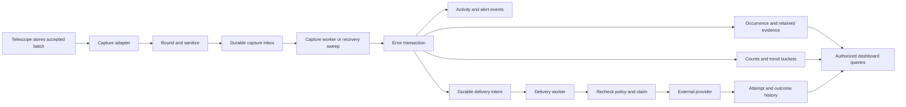

> Capture amendment: [Telescope-source capture](telescope-source-capture.md) supersedes the synchronous inbox-write path below. Host hooks execute zero monitoring database queries; a separate importer performs buffering and processing.

# Telescope Monitor v1 Technical Architecture

Status: Architecture accepted and replacement implementation started  
Updated: 10 November 2026

This design implements the approved error-first product experience as a Composer package inside a Laravel application. The [product specification](product-specification-v1.md) defines behavior; the approved [visual mockups](design/mockups-v1/README.md) define the six main desktop compositions. The companion documents define the [database schema](database-schema-v1.md) and [implementation phases](implementation-plan-v1.md).

This is the approved design for the replacement. [Implementation progress](replacement-progress.md) distinguishes delivered foundation, durable capture and Phase 3 investigation and Phase 4 collaboration plus Phase 5 email alerting and Phase 6 integrations plus Phase 7 operations capabilities from later phases. Saving or approving this document did not itself publish a release or configure live integrations.

## Architecture decisions

| Concern | Proposed decision | Reason |
| --- | --- | --- |
| Deployment | Embedded Composer package, one installation per package table set | Preserves the agreed host application model |
| Runtime | Tested Laravel 8–13 releases, PHP 8.3+, Telescope 5 | Separate framework test harnesses verify the compatibility branches |
| Dashboard | Vue 3, TypeScript, a compatible Vue Router release, and Tailwind CSS 4 utilities | Supports coordinated investigation panels, rule editors, validation, and reusable UI without requiring host frontend integration |
| Server entry | Small package-owned Blade shell and same-origin JSON endpoints | Keeps authentication/session behavior in Laravel |
| Build | Vite at package development/release time; committed/versioned distributable assets | Consumers install through Composer without Node |
| Capture | Telescope adapter followed by a durable database inbox | Survives queue-dispatch failure and moves domain processing off the monitored request |
| Persistence | Host default relational connection; package-owned tables and repositories | Keeps domain transactions on one connection |
| Background work | Host queue driver, dedicated package queue names, database recovery sweeps | Separates capture throughput from network delivery |
| Integrations | Provider adapters behind one delivery interface | Email, Slack, webhooks, and GitHub have genuinely different transport behavior |
| Authorization | Host-resolved capabilities and actor references | No package-owned users or assumption about the host User model |
| Settings | Deployment policy over database preferences over shipped defaults | Editable administration with enforceable host limits |
| Evidence | Sanitized before buffering; encrypted bodies plus minimal indexed projections | Supports investigation and filtering without retaining raw request payloads |
| Delivery guarantee | Durable intent; at-least-once transport where applicable; explicit GitHub ambiguity | Avoids promising atomicity with external providers |

Vue supports application-oriented usage, and its router supports history-mode navigation when the server handles deep links. This design uses those capabilities without requiring the host application to use Vue. [Vue usage modes](https://vuejs.org/guide/extras/ways-of-using-vue.html), [Vue Router history modes](https://router.vuejs.org/guide/essentials/history-mode.html).

The original prototype targeted Laravel 13.42/Telescope 5.27. The current source
expands support through separate Laravel 8–13 test environments; exact framework
floors, dependency handling and results are recorded in the
[framework compatibility report](framework-compatibility.md).

## Package ownership and isolation

The package owns its document shell, routes under a configurable base path, JavaScript mount, compiled assets, styles, models, and tables. It does not extend the host layout or import the host Vite bundle, Tailwind configuration, router, or global JavaScript instance. Tailwind utilities and the package theme are compiled by the package Vite build and rendered in its standalone document. Shared utility recipes preserve the current UI and interaction hooks; the dashboard has no handwritten CSS selectors or inline style bindings. The frontend tests enforce that styling boundary across all Vue components. Fonts and icons are shipped locally with their redistribution notices; no runtime font CDN is required.

The initial base path remains `/telescope-monitor`. A different configured path must work for deep links, assets, login return paths, notifications, and reverse-proxy subdirectories. Source repositories, integration destinations, and canonical public URLs are deployment-validated configuration, not values inferred from arbitrary request headers.

One table set has one stable installation identity. Installation IDs and environment fields support fencing and correct identity, not a partially implemented multi-tenant product. Two host applications cannot share the same package table set. Separate databases/host connection prefixes are required if applications otherwise share infrastructure; arbitrary runtime package-table renaming and a cross-application dashboard are outside v1.

## Module map

Modules expose use cases, not their Eloquent models. Controllers, jobs, and commands call the same small interfaces. Internal repositories can be composed inside a module while the public interface hides lock order, query composition, provider errors, and recovery mechanics.

| Module | Owns | Public operations and outcomes |
| --- | --- | --- |
| Installation and policy | Installation identity, effective configuration, capability/actor adapters, purge fencing | Bootstrap installation, inspect capabilities, resolve effective settings, authorize an operation |
| Capture | Telescope hooks, live normalization, reportability markers, batch correlation, durable inbox | Accept stored batch, replay bounded source range, describe source coverage |
| Error processing | Fingerprints, deduplication, counts, evidence, lifecycle, activity, metric buckets | Process inbox item, investigate error, transition status, explain unavailable evidence |
| Collaboration | Notes, saved views, per-actor view preferences, optional assignments | Add/edit/remove note, save/copy/update view, assign/unassign error |
| Alert planning | Rule matching, thresholds, event arbitration, automatic ticket intent | Plan destinations for a domain event, revalidate pending eligibility, preview a rule |
| Delivery | Claims, cooldown reservations, attempts, transport adapters, uncertainty, explicit retry | Dispatch due work, attempt delivery, inspect history, retry/review an operation |
| Connections and secrets | Connection configuration, immutable target identity, credential revisions, connection tests | Configure/test/disconnect connection, stage/activate secret, resolve runtime credentials |
| Dashboard queries | Authorized read projections, pagination, filtering, insight coverage | Overview, inbox, detail, deliveries, configuration summary |
| Operations | Health observations, recovery, retention, source checkpoints, controlled purge | Probe processing, recover work, prune bounded records, drain and purge an installation |

The overview read projection adds current unresolved-group count, retained-period
comparison buckets, origin identity counts and fresh capture observations. Group
scopes used for aggregate subqueries omit the inbox's count joins. Previous-period
availability checks installation start, aggregate retention and purge cutoff.
Comparison totals omit the partial final interval from both periods; the main
selected total still includes captured events in that interval. Origin counts use
the matching aggregate resolution's first retained bucket boundary and explicitly
report identity/aggregate coverage differences.

Use one repository/interface per persisted model, consistent with the repository conventions in the initial brief. Eloquent stays inside repository implementations. Cross-table reads live in query repositories, not controllers or Vue components. Avoid generating a public generic CRUD layer: the module's callers should not have to orchestrate transactions or coordinate model saves.

Useful host seams are CapabilityResolver, ActorResolver, optional AssignmentDirectory, GroupingPolicy, deployment SecretProvider, and the delivery ProviderAdapter. The default adapters should cover the common host configuration. The package should not introduce a plugin framework, external event bus, or event-sourced persistence system for v1.

ActorResolver derives an opaque reference from the configured host authentication provider and identifier, and can resolve it again for a queued manual action. A default adapter may use the provider's retrieve-by-identifier contract; a custom host can supply a callback. Do not serialize an authenticated user or guess its model class. If deferred actor resolution is unavailable, expose the missing capability and cancel the write rather than impersonating the original user. AssignmentDirectory is a separate optional roster interface.

## End to end flow

There are two local commits: first, buffer sanitized capture; second, process it into error state and notification intent. Neither commit spans Telescope's source connection or an external provider. A successful Telescope write followed by a failed inbox write is recoverable only while reportability-marked source entries still exist. That gap is reported accurately rather than described as lossless capture.

## Telescope integration contract

Register the monitor's storage callback during provider registration, before Telescope boots watchers, and return `true`. In the inspected Telescope 5.27 implementation, storage callbacks are traversed with `every`, and ModelWatcher's callback returns no value. A prior falsey callback can prevent later callbacks from executing. Validate this behavior against the declared support matrix; do not reorder, replace, or clear third-party callback arrays. [Telescope storage implementation](https://github.com/laravel/telescope/blob/v5.27.0/src/Telescope.php), [ModelWatcher](https://github.com/laravel/telescope/blob/v5.27.0/src/Watchers/ModelWatcher.php).

A tag callback adds a small versioned capture marker while the live exception is available. Its metadata identifies reportability, environment, capture time/precision, grouping version/hash, and source epoch. It must contain no message, request content, user identity, or secret. Grouping operates on a documented replay-stable input set. A custom grouping callback cannot depend on an unserialized Throwable or an optional field that disappears during replay.

After storing, accept only stored reportable exception entries in the accepted batch. The adapter handles content that a Telescope repository may have converted to JSON. It normalizes paths consistently across symlinked release directories and retains the source UUID/batch reference. It never serializes a live exception into a job or replaces the Telescope repository.

Related context is a bounded allowlist from accepted source records in the same execution batch. Do not copy every Telescope entry, assume a pending job record is present in a worker batch, or treat interpolated SQL as safe metadata. Missing request/job/log/query context has an explicit coverage reason. Optional class/function names are retained only when available through the supported capture path; recovery may have less detail.

Terminal queue failures require a tested ordering bridge: the prototype observed Telescope flushing and stopping before Laravel's final exception report. Any bridge must feed a not-already-recorded, reportable exception through Telescope's own recording/filter pipeline, respect an enabled ExceptionWatcher, and avoid invoking the host reporter twice. HTTP, sync jobs, retrying jobs, terminal jobs, and command failures need separate fixtures. The bridge is conditional on the integration tests, not an excuse to record all JobFailed events indiscriminately.

Monitor routes, package processing/delivery jobs, probes, and internal failures are excluded from recursive capture. Register the exact monitor path and its descendants in Telescope's runtime ignored-path configuration while preserving the existing list; never replace host filter callbacks, ignore unrelated application paths, or write the host configuration file. A root/wildcard base path is invalid. This exclusion protects the monitor's own credential/evidence administration traffic, without broadening collection of application traffic.

As defense in depth, sensitive package request/response values use a fixed private JSON envelope key registered with Telescope's request/response redaction helpers. Do not flash secret-bearing old input into the session, return credentials in generic Resources, or accept raw text payloads on credential endpoints. Tests must inspect Telescope's own retained request/response entries for note bodies, credentials, one-time generated signing secrets, and redaction-test inputs; excluding them only from the monitor's copies is insufficient. Existing Telescope source records remain governed by their prior retention/privacy policy.

Synthetic onboarding capture runs as a specifically trusted queued probe with an operation receipt and current administrator authorization. Only its explicit synthetic exception is allowed through the package loop guard; normal host recording/reportability/filter rules still apply. A paused or disabled Telescope installation must make the probe fail truthfully, not be temporarily enabled to manufacture success. No ordinary request parameter or arbitrary queued job can enable the trusted test flag.

## Durable capture inbox

Normal inbox items contain an encrypted, already-sanitized, versioned exception envelope plus bounded context. Scalar headers identify the source entry, installation generation, environment, recorded time, grouping policy, privacy revision, and live/recovery/test mode. Jobs receive only an inbox identifier and expected generation.

Proposed initial bounds are 128 KiB of plaintext envelope data per normal item, including the product's message/trace/context bounds. Capture writes use bounded chunks. For exceptionally large batches, a small batch-reference inbox item can defer source reading instead of buffering unbounded context. A batch reference contains identifiers and coverage metadata only; the worker reads and sanitizes accepted source entries before creating any package evidence. This fallback depends on the source still existing and must show degraded capture/processing lag.

No provider network calls, analytics scans, note lookup, or live actor-directory enumeration occur in the monitored request. Queue dispatch happens after the inbox commit and is advisory: a failed dispatch leaves pending work for a sweep. A production sync queue must not cause the hook to run full processing and external delivery inline; it leaves work pending and produces an actionable diagnostics warning. Explicit command-line processing is a separate deployment operation.

The exact inline row/chunk/time budgets are a phase-zero measurement gate. A bounded query count is enforceable; an absolute low latency cannot be guaranteed against a slow host database. Exceeding bounds must produce a recoverable backlog/coverage observation, not silent sampling of errors or a replacement application exception.

## Error processing transaction

For each normal capture, the processor:

1. Verifies the installation state, purge generation, source epoch/cutoff, envelope version, and current privacy limits.
2. Takes the installation shared fence, then obtains the error group through an atomic unique-key upsert and row lock.
3. Inserts the unique occurrence identity. A duplicate is a no-op for counts, metrics, alerts, and activity.
4. Creates expiring evidence and searchable allowed projections. Evidence past its retention window is not recreated by replay.
5. Updates first/last seen and lifetime count; applies a legitimate automatic regression or snooze expiry.
6. Updates eligible event-time metric buckets once, using the occurrence insertion result as the guard.
7. Records immutable alert-event metadata and matching delivery intent, including automatic GitHub reservations when configured.
8. Marks the inbox item complete and commits. After commit, attempts queue dispatch; recovery can repeat it safely.

The processor retries classified database deadlocks with a bounded budget. It does not retry arbitrary programming errors forever. Rejected/malformed or undecryptable items move to a visible failed/quarantined state with a sanitized reason and can be reviewed. Raw envelopes are not printed in application logs.

`occurred_at` means source recording time; `received_at` and `processed_at` are separate. Live timestamps preserve microseconds where supplied. Historical source timestamps can be coarser; retain their precision. A historical event reopens a resolved error only when its lower-bound timestamp is provably newer than the resolution cutoff, and still produces no retroactive notification or automatic ticket. Ambiguous ties preserve the manual state and surface recovered evidence for review.

An error keeps both its current lifecycle timestamps and persistent suppression cutoffs. Ending snooze, reopening an ignored error, or manually reopening a resolved error raises a notification cutoff so delayed pre-action captures cannot immediately generate a misleading alert. Set the cutoff at the actual action/expiry, not at a future snooze deadline that would suppress legitimate events after an early unsnooze.

## Transactions and concurrency

Canonical lock order is installation fence, the relevant capture-inbox or user-action receipt row, issue rows in ascending ID order, notification-gate rows in deterministic destination order, linked-issue reservations, and delivery rows. Settings/purge operations take an exclusive installation fence; ordinary capture and processing take compatible shared fences. SQLite uses its equivalent serialized write transaction; do not pretend its row-lock implementation matches MySQL.

The issue row serializes lifecycle and count changes for one error without serializing unrelated errors behind a global write lock. The prototype's MySQL/MariaDB race demonstrated why “create or read, then lock” must be tested; use an atomic insert/upsert followed by the authoritative locked read. Do not use process-local locks or cache locks as the correctness mechanism.

User edits carry an expected row version. A stale mutation returns a structured conflict with current permitted metadata; it never silently overwrites another edit. Creation and external-write commands also carry a validated client-generated UUID idempotency key. Reusing a key with a different canonical request is rejected. The action-receipt ledger stores a keyed request digest and result references, not note bodies or credentials. A receipt commits with the accepted local operation, including a queued-delivery reference; the provider worker updates that delivery rather than locking the receipt in reverse order.

There is no open database transaction across HTTP or mail I/O. A lease token and generation compare-and-set protect completion updates from stale workers. The unavoidable interval between the final check and provider acceptance is described as in-flight work; a status change or purge cannot recall a request already accepted externally.

## Alert planning and thresholds

The issue transaction obtains one consistent settings/rule revision, records the event, evaluates matching rules, coalesces matching destinations, and persists intended deliveries. This fulfills the product requirement that a state transition and its notification intent commit together. There is no best-effort application event listener whose failure silently loses the only notification intent.

Class/environment filters use issue fields. Origin/tag threshold filters use retained occurrence projections in the fixed event-time window, with an indexed count/EXISTS query and the issue lock. Do not use unfiltered global metric buckets for a tag-filtered threshold. The shortest evidence-retention setting must still cover the maximum one-hour threshold window; v1 validation enforces at least one day of occurrence projections.

A versioned threshold event key combines rule, rule version, issue, and UTC window. Only a crossing from below the configured count fires; replay and remaining above the count do not fire. Historical reconciliation may change historical counts but does not produce threshold alerts. Coalesce same-occurrence threshold matches for a destination, retaining all matching rule/event references. New/regression occurrence events take precedence over simultaneous threshold notices.

Connection identity, not its display name, determines duplicate destinations. Email addresses use documented normalization. Slack/webhook targets use a keyed fingerprint without exposing a secret URL. Overlapping rules result in one logical delivery per canonical event/action/destination/revision, with a separate list of supporting rules. Deleting one rule does not cancel a delivery still supported by another rule.

Default cooldown is per issue and canonical notification destination, shared across occurrence rules. A notification gate reserves one eligible send while an attempt is active and records last successful acceptance. Failure releases the reservation without inventing a successful cooldown. Activity events use their action identity and event-specific eligibility; a resolved activity notification must not be suppressed merely because the error is resolved.

## Delivery and provider interface

The provider interface accepts a sanitized delivery envelope, an immutable target descriptor, and runtime-resolved credentials. It returns a classified outcome: accepted, retryable with earliest retry time, permanent rejection, or uncertain side effect. The adapter hides transport-specific response bodies and exception types. It never returns a raw credential-bearing request exception to a controller, worker failure reporter, or health log.

Adapters cover host mail, Slack incoming webhooks, signed generic webhooks, and GitHub issue operations. Tests exercise the common interface and adapter-specific contracts. The domain ledger owns retries; transport libraries must not independently repeat non-idempotent writes with a hidden retry policy.

The GitHub adapter uses the supported public GitHub API origin and constructs repository paths from validated owner/name values; arbitrary API-base URLs and GitHub Enterprise are not implicitly supported. The Slack adapter restricts webhook origins/path shapes to its declared supported Slack endpoints. Generic webhooks use the stricter deployment network policy. Redirects cannot move any provider request or credential to a different origin.

Sender sequence:

1. Read non-locking routing IDs, then claim under the canonical lock order.
2. Recheck generation, enabled state, initiating actor where required, rule support, lifecycle eligibility, destination revision, expiry, and cooldown.
3. Reserve the notification gate when applicable, increment the actual attempt counter, and commit a short lease.
4. Resolve the permitted credential revision, perform one bounded provider request, and suppress Telescope recording around the full transport operation.
5. Commit the classified outcome only if the claim/generation still matches; record sanitized attempt metadata and release or advance the notification gate.

Proposed defaults: connect timeout 5 seconds, total transport timeout 15 seconds, worker job timeout 45 seconds, lease 120 seconds, and five actual provider attempts with 60/300/900/3600-second backoff. Provider Retry-After/reset values take precedence when later. Host `retry_after` or visibility timeout must exceed the worker timeout. Laravel documents these queue timeout relationships; the chosen driver still needs its own integration checks. [Laravel queues](https://laravel.com/framework/docs/13.x/queues).

Retries retain a logical delivery ID. Jobs are small and may be dispatched more than once; claims make duplicate job dispatch safe while a lease is valid. Expired notification leases return to eligible recovery with at-least-once semantics. Expired GitHub creation leases become Needs review. Pending automatic notifications expire after the configured maximum age, initially 24 hours.

## Immutable payloads and changing policy

Notification bodies are rendered from their immutable event snapshot under current export policy and frozen before the first attempt. Manual GitHub exports freeze their preview-confirmed bytes at explicit confirmation instead; later policy changes cannot rewrite that approval silently. Persist canonical bytes encrypted with a payload digest. Subsequent webhook attempts preserve those body bytes and logical identifiers; timestamps, signatures, and active signing key can change per attempt as specified in the product contract.

If a later privacy policy would prohibit an already-attempted immutable payload, cancel it instead of silently retrying forbidden data or mutating the body under the same identity. A separately reviewed resend receives a new delivery revision/ID linked to the original. An unchanged, still-permitted failed delivery can be explicitly retried with an audited retry cycle and bounded attempt budget. The UI distinguishes Retry from Review and resend.

Changing a repository or endpoint creates a new target revision/fingerprint. Old pending work is cancelled; it is not silently redirected. Replacing a GitHub token for the same repository can unblock a reviewed retry. Replacing a Slack webhook URL is a target change even if its human channel label remains the same.

## GitHub issue reservations and uncertainty

A linked-issue record can be reserved before it has a remote number. Its unique issue/repository key prevents two workers or operators from concurrently scheduling independent creation. The export preview is sanitized and persisted with its action/actor references; credentials are resolved only during execution.

Accepted creation records the validated remote issue number and URL. A crash after acceptance but before the local commit, lost response, or expired creation lease leaves a Needs review reservation. Do not automatically retry creation because a subsequent list/search failed to find the issue; negative results can be incomplete or delayed.

Include a stable, non-secret installation/error/action marker in the generated GitHub body to aid review. Recovery supports read-only inspection and explicit Link existing, or an operator's recorded confirmation that no ticket exists before a new creation attempt. Reauthorization and target validation still apply. Pull requests and unrelated repositories are rejected. There is no two-way issue synchronization or implicit close/reopen in v1.

## Settings, secrets, and worker freshness

Settings are versioned by group. An installation configuration revision changes atomically with any setting, connection, secret activation, or rule edit. Effective reads combine deployment-enforced values/limits, saved preferences, and defaults, and include per-field source/lock metadata for the UI.

Each background operation compares the authoritative database revision before acting. A process-local cache can reuse a matching immutable snapshot but cannot be the sole source of truth in a long-running worker. Database revision checks provide correctness even when optional cache invalidation messages are lost. Capture bootstrap can use a deployment-only safe baseline until schema setup is complete; it must not emit alerts before configuration is available.

Secrets are separate encrypted records with purpose, revision, public key identifier when needed, and staged/active/retiring state. Database and deployment secret providers are distinct adapters. Neither sends plaintext values to the browser after creation. Missing/invalid encryption keys produce a visible configuration failure, not silent deletion or fallback to an older secret.

Webhook signing uses the exact versioned contract in the product specification. Stage, test, activate, and retire keys explicitly. Destination validation is deployment-enforced: no redirect following, HTTPS and host/path validation, prohibited metadata/link-local targets, and an explicit allowlist for permitted private destinations. The transport must bind DNS resolution/connection to the validated address while preserving correct TLS hostname verification; merely validating a URL once is insufficient.

## Dashboard interface and request contracts

Laravel serves the authenticated shell and same-origin JSON under the configured base. Session/CSRF middleware protects mutations; the package does not add a separate token authentication system or enable cross-origin APIs by default. Laravel's request-forgery behavior must be retained. [Laravel CSRF protection](https://laravel.com/framework/docs/13.x/csrf).

| Surface | Proposed route family | Important contract |
| --- | --- | --- |
| Shell and navigation | Base, `/setup`, `/overview`, `/errors/...`, `/alerts/...`, `/integrations/...`, `/settings/...` | Authorized deep links and genuine not-found states |
| JSON | `/api/v1/...` under base | Resources/DTOs, bounded query inputs, explicit capabilities |
| Assets | `/assets/{build}/{allowlisted-file}` under base | Manifest lookup, no arbitrary filesystem paths |
| Reads | GET on overview/errors/occurrences/views/rules/deliveries/connections/settings/health | No secret fields; personal-view owner enforcement |
| Mutations | POST/PATCH/DELETE on resource-specific operations | Form Requests, idempotency keys for creation, expected versions for edits |
| Tests and external actions | POST on test/export/link/retry/review operations | Explicit intent, capability checks, 202 operation receipt when queued |

The SPA fallback must never swallow `/api` or `/assets` failures. Unknown JSON routes return JSON 404, not a successful HTML shell. API errors use a stable code, permitted field errors, and a request/operation reference. Standard outcomes include unauthenticated, forbidden, validation failure, stale-version conflict, rate-limited, and queued/pending.

API data responses use private/no-store policy. Versioned generic assets may use private immutable caching after authorized delivery. Safe bootstrap data includes base URLs, locale, CSRF information, capabilities, feature availability, and asset build ID; it never includes credentials or retained evidence. Escape serialized bootstrap content and render notes/exception text as text, not arbitrary HTML; source links and automatically recognized note links use explicit protocol/origin rules.

URL state serializes inbox filters and selected occurrence IDs according to the product specification. Login return paths remain inside the package/application allowlist. Cancel outdated detail requests so a slow response cannot mix one occurrence's trace with another occurrence's context. Store no evidence, notes, or credentials in localStorage. A bounded poll for a user-initiated queued test is permitted; an automatic live event stream is not required.

## Operations, retention, and purge

Scheduled commands are thin adapters to the operations module. Propose separate bounded operations for capture recovery/processing, due deliveries, snooze expiry, retention, source reconciliation, and health observations. Record attempt/start/success/failure separately so a running scheduler does not masquerade as a successful prune or worker.

Reconciliation uses an ascending checkpoint plus a bounded overlapping revisit window to tolerate concurrent source writes, and offers an explicit bounded historical scan. It never repeatedly examines only the newest fixed page and starves older gaps. Enqueue only entries with supported reportability/grouping markers. Unknown legacy entries are not guessed reportable. Overlap bounds, source pruning, marker delays, and source resets appear as coverage limits.

Pruning removes expiring evidence/tags, expired metric buckets, completed delivery payloads/attempts, and eligible activity in bounded batches. It does not decrement lifetime counts or delete occurrence identity. Events/receipts with pending references are retained until their work is terminal. Detailed policies and foreign-key behavior are in the schema document.

Purge is a resumable, explicitly confirmed maintenance operation. Set the installation to draining, stop new provider claims, drain or wait for package leases, acquire the exclusive fence, advance generation, and record source sequence/time cutoffs. Cancel unsent work and clear the capture inbox and error-domain data in bounded resumable steps. While purging, no new package evidence or provider action is accepted; post-cutoff source events can be recovered after resume if Telescope still retains them, without retroactive alerts. Preserve settings, credentials, views, installation identity, and the minimal purge record. Resume only after verification. Already accepted external messages/tickets remain external.

Old jobs and callbacks carry an expected generation and cannot commit after the fence changes. Source sequence/time cutoffs prevent historical resurrection. A reset or replacement of Telescope storage requires explicit source-epoch rebaselining; do not silently discard purge watermarks when a sequence decreases.

## Compatibility and release gates

Primary production targets are MySQL 8 and a declared maintained MariaDB baseline. SQLite remains a supported workbench/test target and any production claim requires its own workload limits and correctness matrix. PostgreSQL is deferred until its transaction, indexing, and migration matrix passes. Database/Redis queues are initial candidates; other host drivers are added only with their visibility-timeout and recovery tests.

No fixed throughput or latency promise is made before measurement. Phase zero measures capture cost, worst-case context bounds, concurrent grouping, dedupe growth, evidence pruning, and delivery backpressure using representative volumes. The dashboard must paginate and constrain date windows from the beginning; no endpoint loads all occurrences or arbitrary source batches into memory.

The replacement uses the same general package namespace/table prefix unless naming review changes it. Existing prototype tables without the replacement installation/schema marker cause an explicit installation diagnostic. They are not overwritten, dropped, or silently adopted. An unreleased prototype data converter is optional separate work; it is not promised release compatibility.

The [implementation plan](implementation-plan-v1.md) turns these decisions into gated vertical slices. The frontend stack and overall architecture have been accepted. Measured capture limits, the exact tested compatibility matrix, optional secret-provider integrations and any prototype data converter remain explicit implementation gates. Live publication or external test destinations still require their own authorized setup.

## Accepted storage configuration addendum — 11 November 2026

The user approved using Telescope's database connection as the package default, with an optional `TELESCOPE_MONITOR_DB_CONNECTION` override. Resolution is monitoring override → Telescope storage connection → host default when unset. All 25 package tables and intra-package foreign keys use that effective connection, including migrations, schema diagnostics, models, transactions, callbacks, retention and purge. Telescope reads, user identity resolution and broker storage remain independently configured. No cross-database foreign key or atomic source/monitor/broker transaction is assumed.

A package-only migration command scopes files and the ledger to the selected connection. New migrations publish in a subdirectory for nondefault storage; migration suffixes remain stable. Connection changes do not move data and require explicit deployment planning. The sealed rc.1 archive predates this addendum; it remains unchanged.

## Accepted explicit historical import addendum — 11 November 2026

The user requested import of retained pre-install Telescope exception history. This is a separate privileged CLI operation, not a relaxation of signed live capture/reconciliation. An explicit original environment is required for unsigned rows; reportability remains unavailable. Source rows/tags remain unchanged, and unsigned package-private release/route/origin fields are not trusted.

The importer pages by source sequence with a fixed ceiling, existing byte bounds, a read-only dry run and replay-safe UUID identity. Sanitization precedes encrypted durable buffering; the normal processor rechecks privacy, retention and generation/epoch/purge fences. Historical mode never reopens/unsnoozes existing issues, creates alert events/intent, triggers GitHub creation or inflates live frequency counts. Current retention applies from event time; expired evidence is not rehydrated. No new table or schema migration is required.
